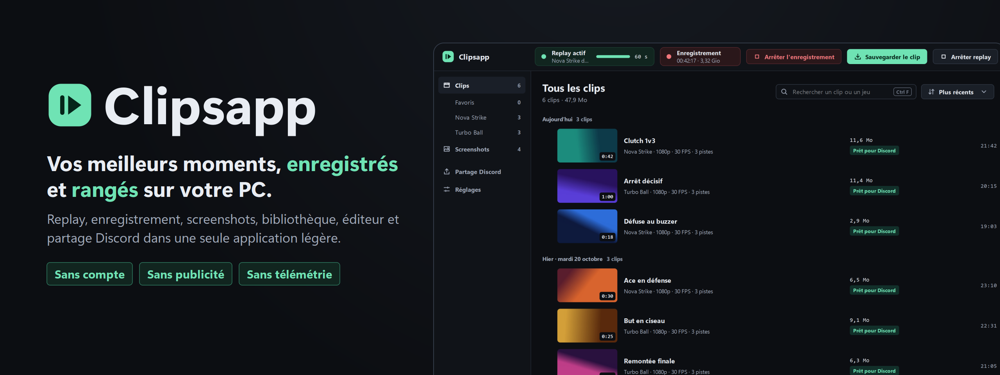
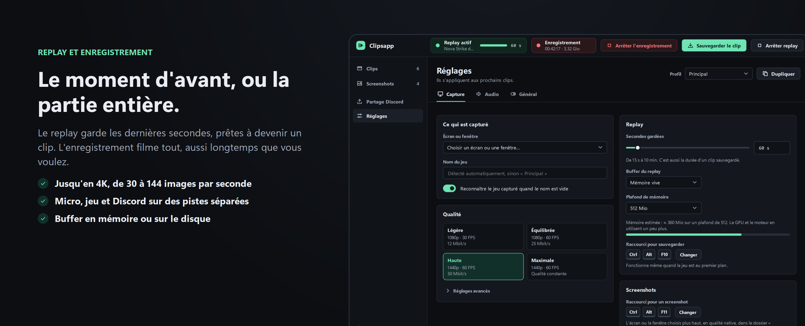
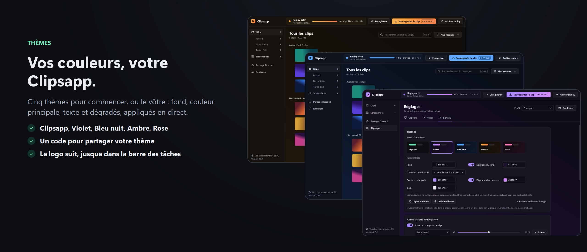
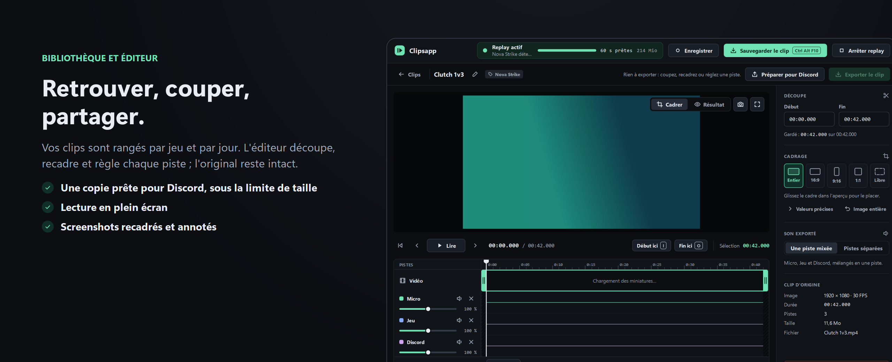

<p align="center">
  
</p>

<p align="center">
  <a href="https://github.com/LED-N/Clipsapp/releases/latest"></a>
  <a href="https://github.com/LED-N/Clipsapp/releases"></a>
  
</p>

<h3 align="center">
  <a href="https://github.com/LED-N/Clipsapp/releases/latest/download/Clipsapp-windows-x64.zip">⬇ Télécharger Clipsapp pour Windows</a>
</h3>

Clipsapp garde les dernières secondes de votre écran pendant que vous jouez : un raccourci, et le moment devient un clip. Il enregistre aussi une partie entière, prend des screenshots, range le tout par jeu, et sert ensuite à retrouver, couper et envoyer vos clips sur Discord.

Il existe pour une raison simple : réunir dans une seule application légère le replay, à la manière d'OBS, et le rangement des clips, à la manière de SteelSeries Moments. Sans suite logicielle autour, sans compte, sans publicité et sans télémétrie.

## En bref

| Raccourci | Ce qu'il fait |
|---|---|
| <kbd>Ctrl</kbd> + <kbd>Alt</kbd> + <kbd>F10</kbd> | Sauvegarde les dernières secondes du replay en clip |
| <kbd>Ctrl</kbd> + <kbd>Alt</kbd> + <kbd>F9</kbd> | Lance l'enregistrement, et l'arrête |
| <kbd>Ctrl</kbd> + <kbd>Alt</kbd> + <kbd>F11</kbd> | Prend un screenshot en qualité native |

Les trois fonctionnent pendant que le jeu est au premier plan, et se changent dans **Réglages → Capture**.

## Replay et enregistrement

<p align="center"></p>

- **Replay** : de 15 secondes à 10 minutes gardées en continu, prêtes à devenir un clip d'un raccourci. Il peut démarrer avec Windows, ou seulement quand un de vos jeux est ouvert, et s'arrêter tout seul après lui.
- **Enregistrement** : une partie entière, sans limite de durée, lancée et arrêtée d'un même raccourci. Il tourne seul ou à côté du replay : chacun a sa barre, verte pour le replay, rouge pour l'enregistrement, et vous pouvez toujours sauvegarder des clips pendant ce temps. Le fichier reste lisible même si le PC s'arrête en cours de route.
- **Qualité au choix** : quatre préréglages, de « Légère » à « Maximale », ou des réglages avancés : jusqu'en 4K, de 30 à 144 images par seconde, H.264 ou HEVC, débit cible ou qualité constante jusqu'au quasi sans perte. Chaque réglage est expliqué par une infobulle.
- **En mémoire ou sur le disque** : le replay garde ses secondes en mémoire, ou sur un SSD pour un long replay qui laisse la mémoire au jeu. Clipsapp vous le propose quand le replay deviendrait lourd.
- **Son en pistes séparées** : micro, jeu et Discord, chacun sur sa piste, pour les régler ou les couper après coup. « Tout, sauf exclusions » enregistre le son de toutes vos applications, sauf celles que vous écartez, comme Discord ou le navigateur.

## Thèmes

<p align="center"></p>

- **Cinq thèmes pour commencer** : Clipsapp, Violet, Bleu nuit, Ambre et Rose.
- **Ou le vôtre** : le fond, la couleur principale et le texte, un dégradé pour le fond et un pour les boutons. Chaque couleur essayée s'affiche aussitôt dans toute la fenêtre.
- **Le logo suit** : dans la fenêtre, la barre des tâches, la zone de notification et le menu Démarrer.
- **À partager** : « Copier le thème » donne un code d'une ligne, à envoyer à un ami, que « Coller un thème » reprend dans son Clipsapp. Le thème Violet, par exemple :

  ```
  clipsapp-theme-0F0B17-A98BFF-EEEAF7-1C1030-D48BFF-135
  ```

Tout se règle dans **Réglages → Général → Thèmes**.

## Bibliothèque, éditeur et Discord

<p align="center"></p>

- **Bibliothèque** : vos clips rangés par jeu et par jour, avec favoris, recherche et renommage. Les clips ajoutés ou supprimés dans l'Explorateur apparaissent aussitôt.
- **Éditeur** : découpe, recadrage (16:9, 9:16 pour les formats verticaux, 1:1 ou libre), volume de chaque piste, export. L'original est toujours conservé, et Clipsapp retient les volumes que vous préférez, jeu par jeu.
- **Lecture en plein écran**, pour regarder un clip ou le montrer sans l'envoyer.
- **Discord** : glissez un clip dans une conversation, ou préparez-en une copie sous la limite de taille, en un clic ou par lot.
- **Screenshots** : rangés par jeu, à part des clips, regardés en plein écran, recadrés ou annotés (pinceau, flèche, cadre, ellipse) dans une copie.

## Installer

1. **[Téléchargez l'archive](https://github.com/LED-N/Clipsapp/releases/latest/download/Clipsapp-windows-x64.zip)**, ouvrez-la et glissez le dossier `Clipsapp` où vous voulez, par exemple dans `Documents`. Évitez `Program Files`.
2. Lancez `Clipsapp.exe`, dans ce dossier.
3. Au premier lancement, Windows peut afficher « Windows a protégé votre ordinateur » : cliquez sur **Informations complémentaires**, puis **Exécuter quand même**. Clipsapp n'est pas signé, c'est la raison de cet avertissement.

Clipsapp pose ensuite quatre questions (dossier des clips, écran ou fenêtre, sons, raccourci) et propose de s'ajouter au menu Démarrer ; le replay peut alors tourner.

## À savoir

- **Système** : Windows 11, 64 bits, avec une carte graphique NVIDIA (NVENC) ou AMD (AMF). Clipsapp est développé et essayé avec une carte NVIDIA ; il n'a pas encore été essayé avec une carte AMD.
- **Rien d'autre à installer** : tout ce dont Clipsapp a besoin est dans son dossier.
- **Discret** : la croix de la fenêtre range Clipsapp, et son replay, dans la zone de notification, près de l'horloge. Pour le fermer vraiment : clic droit sur son icône, puis **Quitter**. Ce comportement se désactive dans **Réglages → Général**.
- **Mises à jour** : Clipsapp signale une nouvelle version à son lancement et l'installe en deux clics, sans toucher aux clips ni aux réglages, puis présente ce qu'elle apporte. Un clic sur le numéro de version, en bas à gauche, rouvre ces notes, version par version.
- **Vie privée** : vos clips et vos réglages ne quittent pas votre PC. La seule connexion de Clipsapp est la recherche de mises à jour auprès de GitHub, qui ne contient que son numéro de version. Elle se désactive dans **Réglages → Général**.
- **Désinstaller** : lancez `Desinstaller Clipsapp.bat`, dans le dossier de Clipsapp. Il ferme Clipsapp, retire son raccourci du menu Démarrer et son lancement avec Windows, puis supprime le dossier. Il propose de garder vos réglages ; vos clips ne sont pas touchés.

## Un problème, une idée ?

Écrivez dans l'onglet [Issues](https://github.com/LED-N/Clipsapp/issues), avec la version affichée en bas à gauche de Clipsapp. **Réglages → Général → Copier le diagnostic** met dans le presse-papiers ce qui aide à comprendre le problème, sans le nom de votre compte.

## Compiler depuis les sources

Deux scripts suffisent sous Windows. Ils installent leurs outils (Qt 6, MinGW, CMake, FFmpeg) dans le dossier du projet, sans rien changer au système ; [7-Zip](https://www.7-zip.org/) doit être installé.

```powershell
.\scripts\bootstrap-windows.ps1
.\scripts\build-windows.ps1 -Test -Package
```

L'application prête à l'emploi se trouve ensuite dans `dist\Clipsapp`. Les images de ce README sont faites à partir de la vraie interface par `clipsapp_readme_images`. Les composants tiers et leurs licences sont listés dans [THIRD_PARTY.md](THIRD_PARTY.md).
